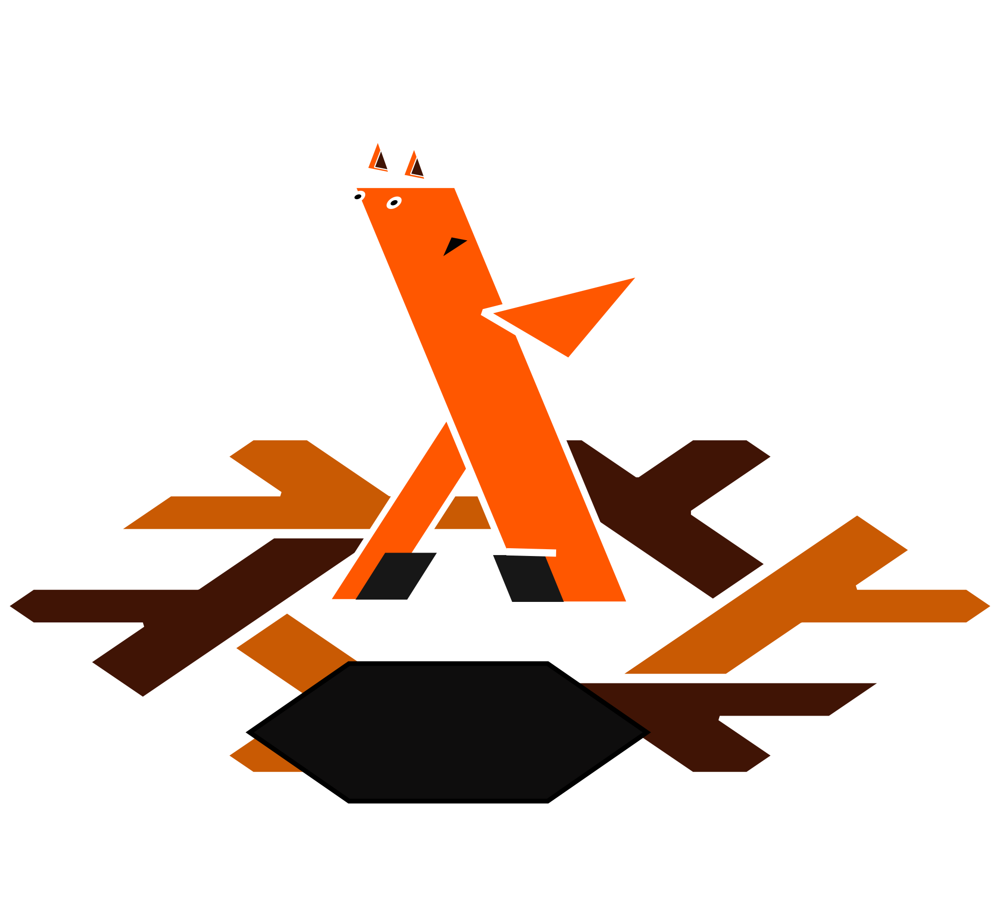

# Burrow

  Burrow logo
</img>

Burrow is an auto-discovery framework for Nix flakes, designed to be both easily usable and nearly infinitely extensible.

Burrow is built to solve nearly every problem I have with flakes & existing auto-discovery systems. 

* Monolithic flakes.
* Auto-discovery systems forcing you to a strict convention.
* Auto-discovery systems not allowing cusomization of outputs.
* Auto-discovery systems only pertaining to one type of output (nixos host, packages, etc...)

## How it works.

Burrow revolves around 1 major primitive, builders.

### What do builders do?

Builders are the part that turns discovered inputs into usable flake outputs.

Builders in burrow:
* Define build functions to turn discovered items into flake-outputs.
* Define aggregate functions to manipulate all outputs into one or more if needed.
* Define modules, usually containing just options that will be evaluated the meta.nix being evaluated.
* Define settings (optionally) to allow the entire builder to be configured.

Additionally, the builder API is the only thing that cannot be changed in Burrow.

The function that discovers buildable inputs however can be changed. (Burrow will package additional discovery functions if needed.)

### Discovery.

In its default state, all builders will use the [`lib.discover`](lib/discovery.nix#L37-L107) function.
This function crawls the search paths like so.

```
search_path/
L meta.nix   : the 'top-level' meta. contains meta.nix options evaluated with everything found.
L obj1/      : A buildable object. this will be passed to the build functions. 
| L meta.nix : The meta.nix for this object, evaluated before passing to build functions.
| ...        : This patten can continue on with subdirectories of the search path being the locations of buildable objects.
```

The discovery function can be changed, however it ***MUST*** take in the same arguments as [`lib.discover`](lib.discovery.nix#L37-l107)
